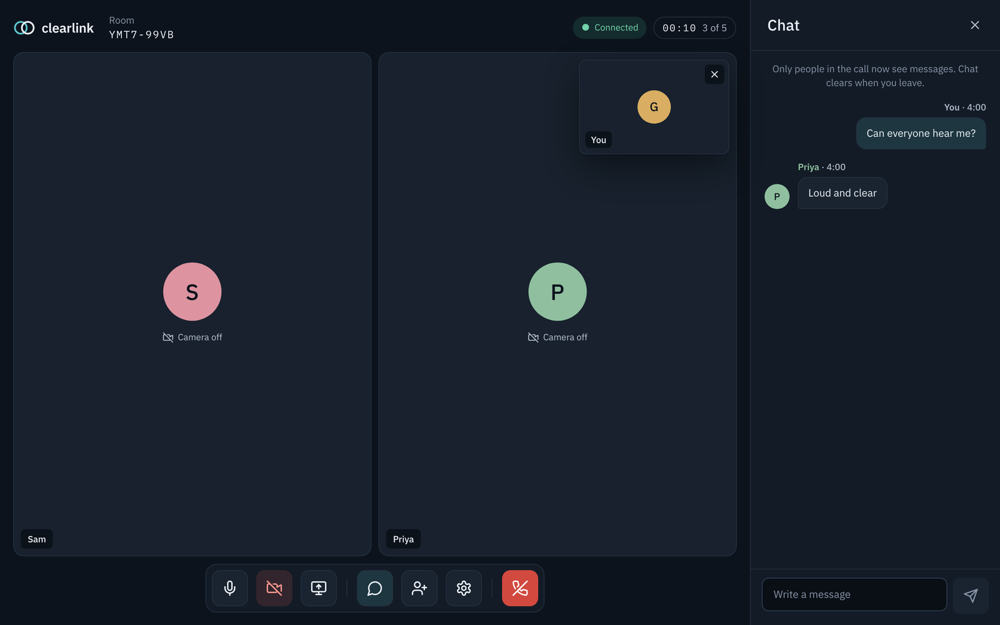
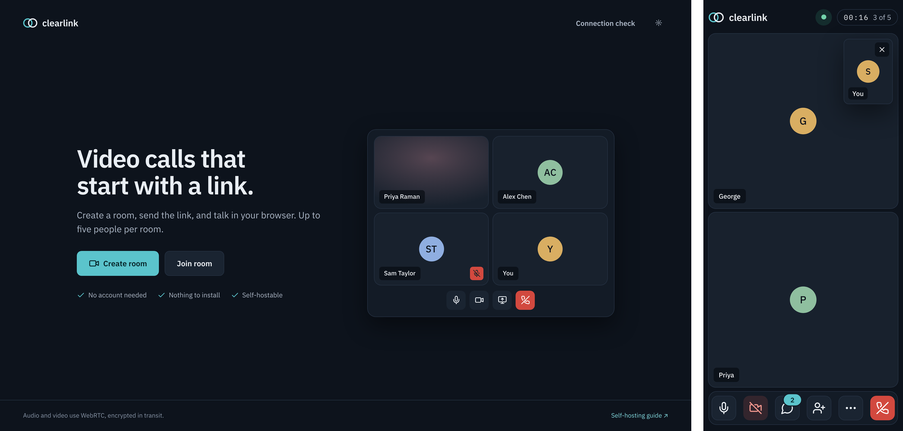
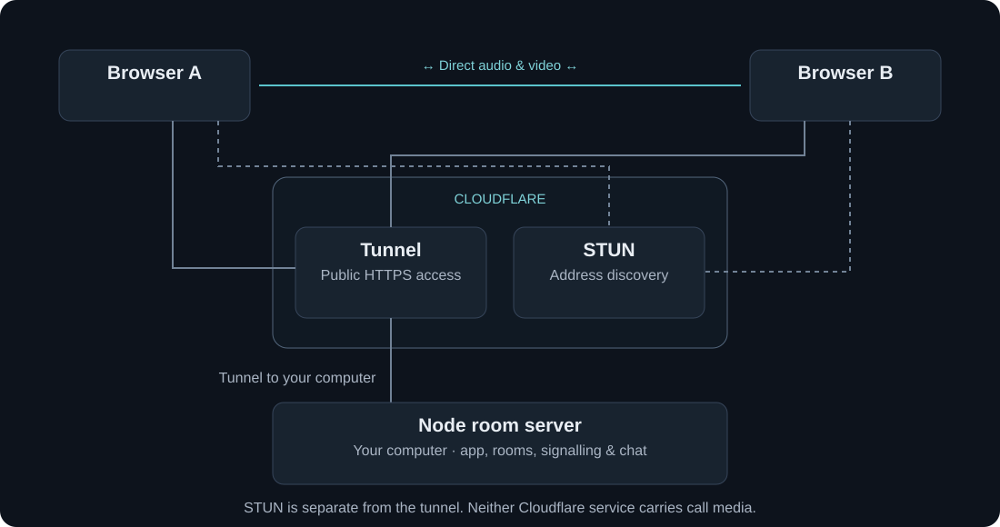

# Clearlink

Video calls that start with a link. Create a room, send the link, and talk in the browser: up to five people, no accounts, nothing to install.

Audio and video go straight between the browsers over WebRTC. A small Node server introduces people to each other and passes chat along, but never carries the call.



 

## Features

- Invite links and eight-character room codes, up to five people per room
- Camera and microphone preview, device switching, mute and camera controls
- Group and spotlight views, with a self-view you can drag or hide
- Screen sharing on desktop
- In-call chat
- Desktop and phone layouts, dark and light themes, reduced-motion support



## Quick start

Needs [Node.js](https://nodejs.org) 20 or later.

```sh
npm install
npm start        # http://localhost:3001, for calls on this computer
npm run share    # a public https link, for calls with other devices
```

Both commands build the app first. Press Ctrl+C to stop.

`npm start` is enough to try it with two browser tabs. To call someone on another device, use `npm run share`. It needs Cloudflare's free [`cloudflared`](https://developers.cloudflare.com/cloudflare-one/connections/connect-networks/downloads/) (on macOS, `brew install cloudflared`). Browsers only allow camera access on `localhost` or HTTPS, so other devices need the HTTPS address it prints.

If port 3001 is taken, use `PORT=3002 npm start`.

## How it works



1. **Node serves the app and keeps track of rooms.** Rooms live in memory, hold up to five people, and close when everyone leaves.
2. **Browsers swap connection details through Node.** Offers, answers and network candidates travel over long-polling requests.
3. **STUN finds a direct route.** Each browser learns its public address from Cloudflare's STUN server, then the browsers test routes until one works.
4. **The call goes browser to browser.** Audio, video and screen sharing are encrypted and never pass through Node or the tunnel. Chat goes through Node, to whoever is in the room at the time.

Every person connects to every other person (a full mesh), which is why rooms stop at five. A few details that keep calls stable:

- **One offerer per pair.** The browser with the lower ID always starts the connection, so two browsers never collide by offering at once.
- **Late camera results are discarded.** Each camera or microphone request is numbered, and anything that arrives after you've left or switched devices is stopped straight away, so the camera light never stays on.
- **Retry restarts the route search** (an ICE restart) without dropping the call.

## Limitations

- **Direct calls only.** Some workplace and university networks block direct connections, so calls there won't connect.
- **Five people per room,** because each browser sends its media to every other person.
- **One server process.** Rooms are held in memory and are lost on restart.
- **Tested in Chrome.** The automated tests don't cover Safari or iOS.

## Tests

```sh
npm test               # 12 Node tests
npm run test:browser   # Playwright + Google Chrome
```

The Node tests cover rooms, signalling, chat and camera timing. The browser test runs a five-person call in Chrome and checks that real audio and video reach everyone. Calls have also been tested by hand across different networks, including mobile data.

## Project structure

```
server/            Node room server, signalling, chat and sharing
src/services/      WebRTC connections, camera and microphone, invite sharing
src/state/         app state and actions
src/screens/       start screen, camera check, call, chat, settings
src/components/    buttons, video tiles, control bar, panels
src/styles/        design tokens and styles
tests/             Node and browser tests
```

## Security and licence

See [SECURITY.md](SECURITY.md) for what Clearlink does and doesn't protect, and how to report an issue.

[MIT](LICENSE) © 2026 George Nicholson
