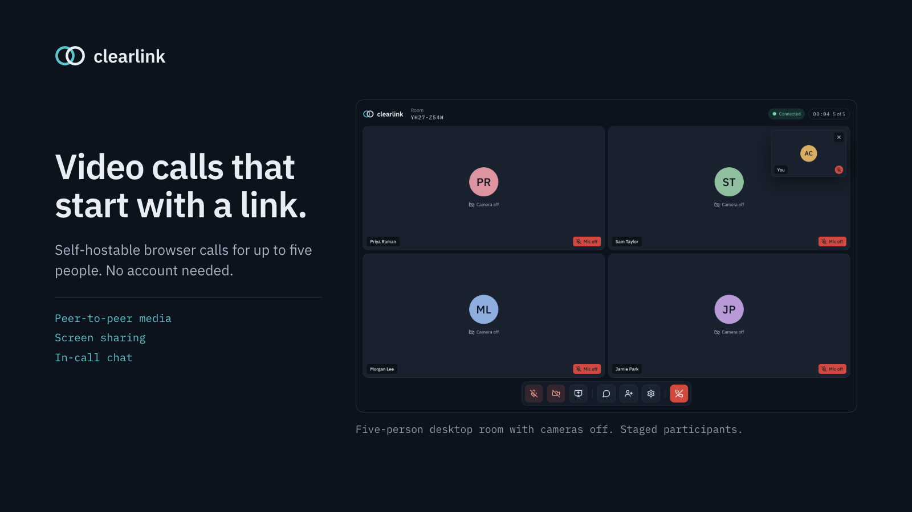
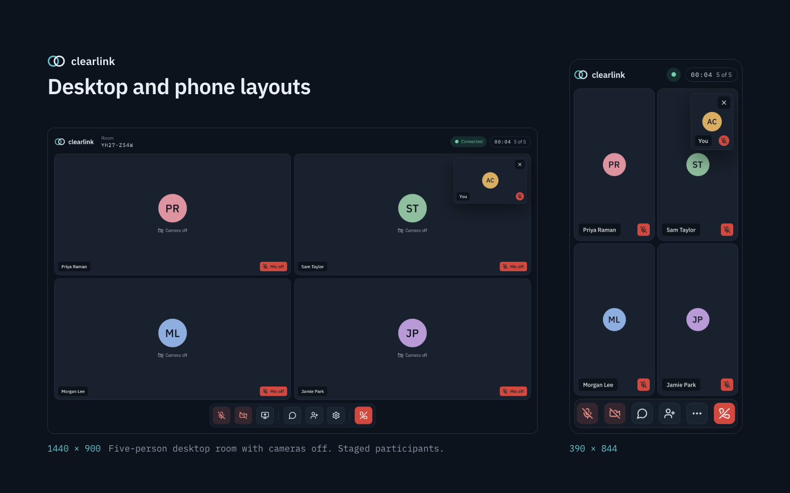
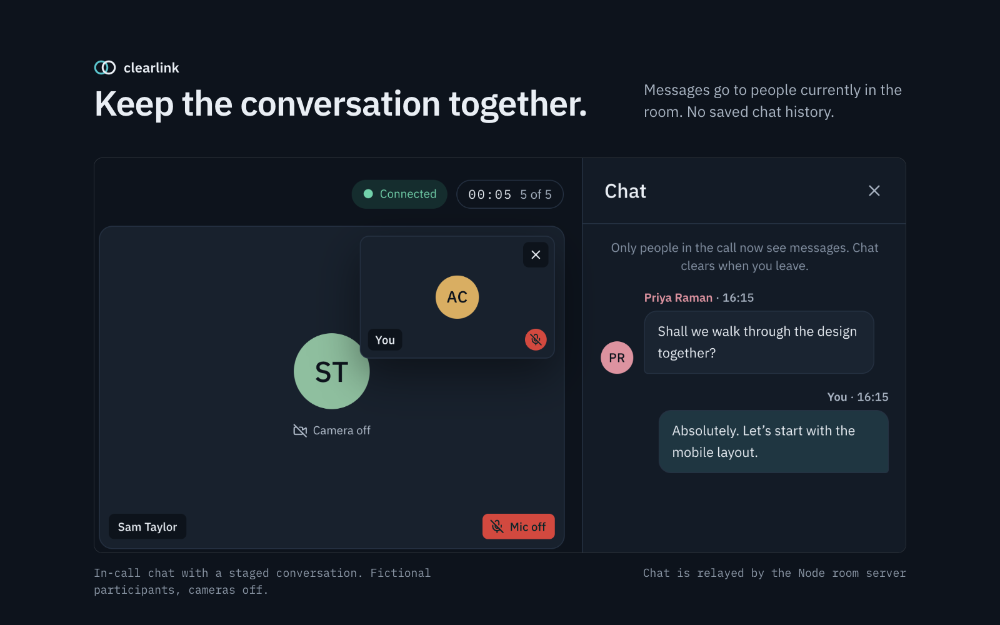

# clearlink



Create a room, send the link, and talk in your browser. Clearlink runs on your own computer, holds calls for up to five people, and sends audio and video directly between participants rather than through a server.

**No accounts · Nothing for guests to install · Screen sharing · In-call chat · Dark and light themes**

 

[Run locally](#run-locally) · [How it works](#how-it-works) · [Share with other devices](#share-with-other-devices) · [Limitations](#limitations) · [Security](SECURITY.md) · [Licence](LICENSE)

## Run locally

Requires [Node.js](https://nodejs.org) 20 or later. Download or clone this repository, then from the project directory:

```sh
npm install
```

Then pick one of two ways to run it:

| Command | Who can join | Use it to |
| --- | --- | --- |
| `npm start` | Only you, on this computer | Try the app, test with two browser tabs, record demos |
| `npm run share` | Anyone you send the link to | Call people on other devices ([needs `cloudflared`](#share-with-other-devices)) |

Both build the app first. Press Ctrl+C to stop either one.

With `npm start`, open **http://localhost:3001**, create a room, enter a display name and check your camera and microphone. People on other devices cannot use this address, because their `localhost` points to their own device; use `npm run share` instead.

If port 3001 is already in use:

```sh
PORT=3002 npm start
```

The server binds to `127.0.0.1` by default. Localhost supports camera and microphone access; a plain HTTP address on your local network normally does not.

## Features

- Invitation links and eight-character room codes, with up to five participants.
- Camera/microphone preview and device selection, mute and camera controls.
- Group view, spotlight, draggable self-preview and preview hiding.
- Desktop screen sharing, with camera restoration when sharing ends.
- In-call chat, invitation sharing, connection recovery, leave and rejoin while the room remains open.
- Responsive desktop and phone layouts, labelled controls and reduced-motion support.
- Dark, light and system appearance, with locally bundled IBM Plex fonts.

## A look inside



*The same room on desktop and at a phone-sized viewport. Fictional participants; cameras and microphones off.*



*Staged conversation in the running app. Chat is forwarded by the Node room server to people currently present.*

## How it works

Clearlink has two traffic paths: browsers exchange call media directly, while the Node server coordinates the room and delivers chat. The diagram shows two participants; each browser establishes a separate media connection to each other participant.


*Shown: the local hosting setup with Cloudflare Tunnel. Other deployments can use their own HTTPS proxy.*

**Between browsers:** encrypted audio, video and screen sharing. **Through Node:** room membership, signalling and chat. **STUN:** helps discover direct routes; it never relays media. The HTTPS proxy or tunnel is explained in [Share with other devices](#share-with-other-devices).

1. **Load the app.** Node serves the built app files. Each participant runs the app in their own browser. A Cloudflare tunnel is one way to give a locally hosted instance a public HTTPS address.
2. **Join a room.** Node tracks participants, enforces the five-person limit and announces joins, departures and microphone/camera status.
3. **Exchange connection details.** Browsers send signalling messages through Node. Cloudflare STUN helps each browser discover its public-facing network address; browsers exchange possible routes and test connectivity.
4. **Talk directly.** Audio, video and screen sharing use browser-to-browser WebRTC connections. Neither the Node room server nor the Cloudflare tunnel carries those media streams in the default configuration.
5. **Keep the room updated.** Browsers receive room events through repeated long-poll requests. Chat text goes through Node, which forwards it to participants currently present.

The tunnel and STUN are separate services: **the tunnel makes the app reachable; STUN helps browsers find direct media routes.** STUN does not relay media. Clearlink uses a server even though its media is peer-to-peer.

Room membership, session tokens and pending events live in server memory. Chat may wait briefly in a delivery queue, but there is no persistent chat history or replay for later arrivals. Empty rooms are deleted and inactive sessions expire. Restarting Node loses room state. Keep it running throughout calls: membership, chat and connection recovery depend on it.

## Share with other devices

To call people on other devices, install Cloudflare's free [`cloudflared`](https://developers.cloudflare.com/cloudflare-one/connections/connect-networks/downloads/) tool (on macOS: `brew install cloudflared`), then run:

```sh
npm run share
```

This builds the app, starts the server on a free port and opens a temporary Cloudflare tunnel. Open the public `https://….trycloudflare.com` address it prints, create a room, and send the invitation from there. Press Ctrl+C to stop sharing.

The public address exposes the locally hosted app. Your computer, Node and the tunnel must stay running. This is temporary hosting, not a permanent deployment; the tunnel does not start automatically.

For a persistent deployment, build the app and run **one Node process** behind trusted HTTPS. Keep `/api` on the same origin, do not cache it, and allow long-poll requests to remain open for at least 35 seconds. Node uses HTTP locally; the HTTPS proxy or tunnel provides the public entry point.

| Setting | Default | Purpose |
| --- | --- | --- |
| `PORT` | `3001` | Node listener port. |
| `HOST` | `127.0.0.1` | Listener address. Use `0.0.0.0` only when required by the hosting environment. |
| `ICE_SERVERS_JSON` | Cloudflare STUN | Replaces the complete list of STUN/TURN servers supplied to browsers. |

The default STUN address is `stun:stun.cloudflare.com:3478`. To supply the same configuration explicitly:

```sh
ICE_SERVERS_JSON='[{"urls":"stun:stun.cloudflare.com:3478"}]' npm start
```

An explicit `ICE_SERVERS_JSON='[]'` disables external STUN/TURN for isolated testing; it does not remove the Node server and may reduce connectivity. TURN configuration is supported, but deploying a relay is deferred. If adding one later, use scoped, short-lived credentials: ICE credentials are sent to participating browsers, so never supply an administration secret.

## Privacy and security boundaries

- WebRTC encrypts call media in transit. The application does not record it; participants can independently record or copy what they receive.
- Chat passes through Node as readable text at the server. HTTPS protects browser-to-server transport; it does not provide end-to-end encryption of chat. A TLS-terminating proxy such as the public tunnel is also part of the trust boundary.
- Anyone with a room invitation can join while space remains. There are no accounts, waiting rooms, host approval or moderator controls. Treat the invitation as room access.
- There is no database or persistent chat history. STUN can observe public-facing network addresses, and direct peers may learn one another’s connection addresses.
- Membership checks, random session tokens and room codes, basic rate limits, request-size limits and cross-site request rejection provide safeguards. They do not constitute a security audit.

## Limitations

- **Direct connections only by default.** Without TURN, some networks cannot exchange media even when loading the app and joining a room succeed.
- **Five people per room.** Each browser sends media to the others; bandwidth and device performance affect call quality.
- **One server process.** Rooms are in memory and are not shared across replicas or preserved across restarts.
- **Browser coverage is limited.** Automated checks use Chrome with simulated capture devices. They do not establish Safari/iOS compatibility, physical device quality or universal internet connectivity.
- **Diagnostics are simulated.** `/test` is a demonstration screen, not a real device or network test.

## Development and demo mode

Run these in separate terminals:

```sh
npm run server
```

```sh
npm run dev
```

Open the URL printed by Vite. Its `/api` proxy targets Node on port 3001; changing the backend port also requires updating that proxy in `vite.config.ts`.

Open `/?demo` to explore simulated room states. Demo mode can still use your actual camera if **My camera** is selected; choose **Simulated** for a preview without capture.

The optional `npm run lan:setup` and `npm run lan` scripts create and serve local test certificates. Other devices require manual certificate trust; these scripts are not a public HTTPS deployment. Private keys stay in ignored `.local-tls/`.

## Validation

```sh
npm run build
npm test
npm run test:browser
```

The 12 Node tests cover media lifecycle races, ICE configuration, room membership, signalling isolation, chat and room lifecycle. Browser tests use Google Chrome and Playwright with fake capture devices, verify actual received audio/video bytes in five browser sessions, enforce the sixth-person limit, and check chat, mute, camera, capture cleanup and rejoin. They also verify theme switching, code validation, settings access on desktop/mobile and real invitation URLs.

Browser tests require Playwright and Google Chrome. Install Playwright locally using `npm install --no-save --package-lock=false playwright`, or set `PLAYWRIGHT_MODULE` to an existing module path. Screenshots go to `/tmp/clearlink-browser-test` (override with `TEST_OUTPUT_DIR`).

Calls have been manually confirmed between devices on different networks, connected directly via STUN through the Cloudflare tunnel. Fake-device tests do not establish physical microphone quality, Safari/iOS behaviour, screen-picker interactions or all internet network combinations.

## Project structure

- `src/screens/`: journeys and call panels.
- `src/components/`: accessible UI, participant tiles and media rendering.
- `src/state/useApp.ts`: call state and actions.
- `src/services/`: WebRTC sessions, browser capture, invitations and demo services.
- `src/styles/tokens/clearlink.css`: design tokens.
- `src/styles/clearlink.css`: layout and semantic styling.
- `server/`: in-memory rooms, signalling, chat, ICE configuration and optional LAN tooling.
- `tests/`: media, room and browser validation.

IBM Plex fonts are bundled from Fontsource under their included OFL licenses. Icons use locally rendered SVG paths. No font CDN is contacted by the running application.

## Licence

[MIT](LICENSE) © 2026 George Nicholson
